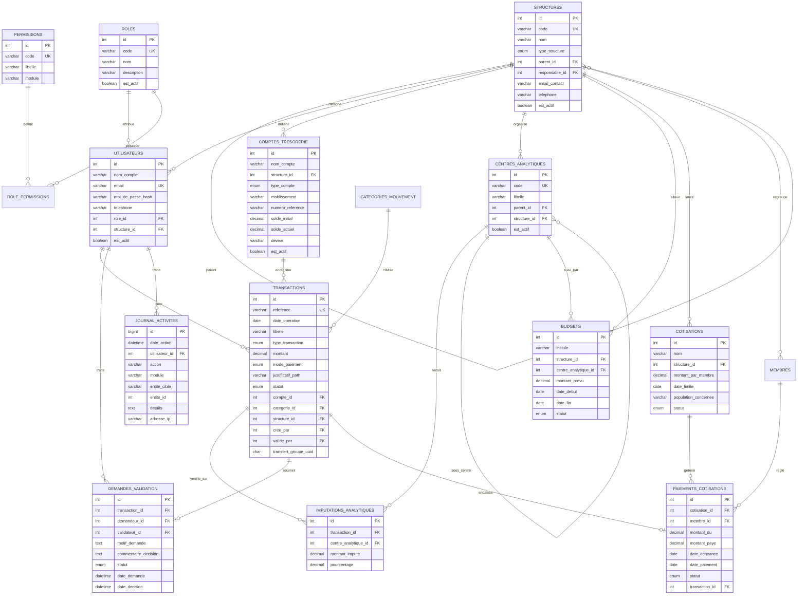
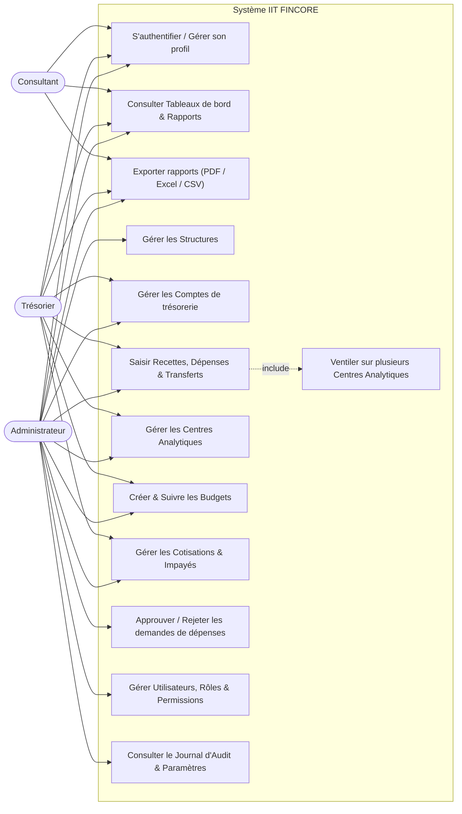
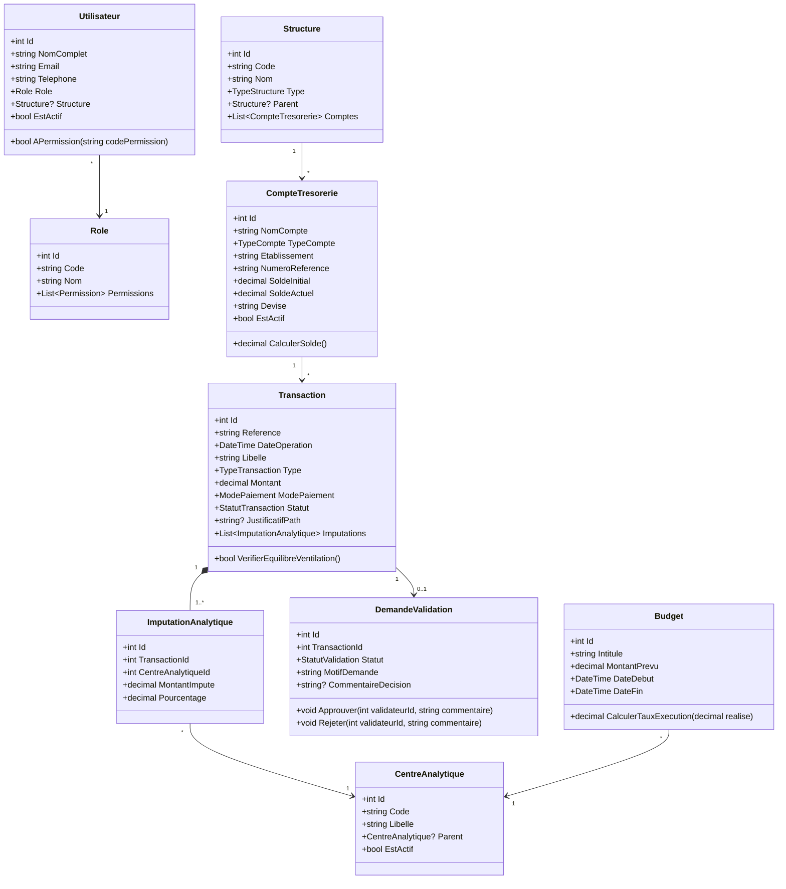
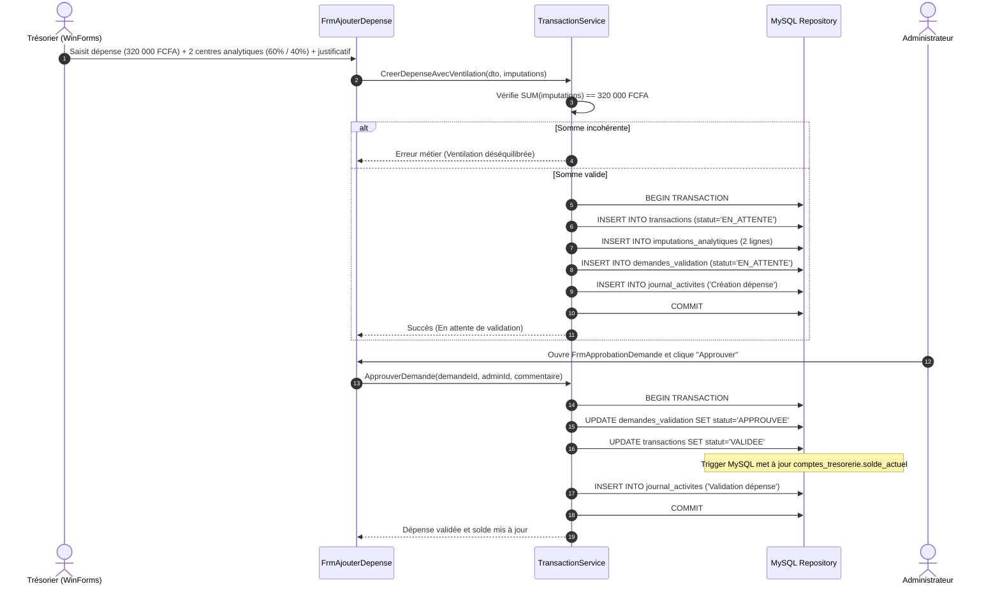

# Dossier d'Analyse et de Conception — IIT FINCORE
**Solution de Gestion d'une Mini-Trésorerie d'Association (C# .NET WinForms & MySQL)**

---

## 1. Synthèse de l'analyse (Cahier des charges + 45 Maquettes HD)

L'application **IIT FINCORE** permet la gestion centralisée et multi-structures de la trésorerie associative (ex. : *IIT*, *BDE*, *IT CLUB*, *Club Sportif*, etc.) en **FCFA**, avec :
- **Gestion des comptes de trésorerie** (Banque, Caisse, Mobile Money) rattachés aux structures.
- **Gestion des mouvements de trésorerie** : Recettes, Dépenses (avec pièces justificatives) et Transferts entre comptes.
- **Gestion des centres d'imputation analytiques** avec **multi-ventilation** (répartition d'un même mouvement sur plusieurs centres analytiques).
- **Modules complémentaires présents dans les maquettes** :
  - Tableaux de bord (général et par structure),
  - Budgets & suivi budgétaire par centre analytique,
  - Circuit de validation / approbation des demandes de dépenses,
  - Campagnes de cotisations, paiements et suivi des impayés,
  - Rapports & exports (synthèse financière, recettes, dépenses),
  - Authentification et contrôle d'accès basé sur **3 rôles** (**Administrateur**, **Trésorier**, **Consultant**) avec matrice de permissions,
  - Journal d'audit des activités et paramètres généraux.

### Cartographie des 45 écrans par module

| Module | Écrans (Maquettes) | Rôles autorisés |
| :--- | :--- | :--- |
| **Authentification** | 01 Splash, 02 Connexion, 03 Mot de passe oublié | Tous |
| **Tableaux de bord** | 04 Général, 05 Par structure | Admin, Trésorier, Consultant |
| **Structures** | 06 Liste, 07 Créer, 08 Modifier, 09 Détails | Admin (CRUD), Trésorier/Consultant (Lecture) |
| **Comptes** | 10 Liste, 11 Créer, 12 Modifier, 13 Détails | Admin, Trésorier (sa structure), Consultant (Lecture) |
| **Transactions** | 14 Mouvements, 15-16 Recettes, 17-18 Dépenses, 19 Détails, 20 Transfert, 21 Historique | Admin, Trésorier (Saisie), Consultant (Lecture) |
| **Budgets** | 22 Liste, 23 Créer, 24 Suivi budgétaire | Admin, Trésorier, Consultant (Lecture) |
| **Validations** | 25 En attente, 26 Détails, 27 Approbation, 28 Historique | Admin (Valider/Rejeter), Trésorier (Soumettre/Voir) |
| **Cotisations** | 29 Liste, 30 Créer, 31 Paiements, 32 Impayés | Admin, Trésorier, Consultant (Lecture) |
| **Rapports** | 33 Synthèse, 34 Recettes, 35 Dépenses, 36 Exportation | Admin, Trésorier, Consultant |
| **Utilisateurs & RBAC** | 37 Liste, 38 Créer, 39 Détails, 40 Rôles, 41 Permissions | Admin uniquement |
| **Audit & Paramètres** | 42-43 Journal activités, 44 Profil, 45 Paramètres généraux | Admin (Audit/Paramètres), Tous (Profil) |

---

## 2. Règles de gestion (RG)

- **RG1 — Unicité et traçabilité** : Chaque transaction validée possède une référence unique générée automatiquement (ex. `TRX-2026-0001`).
- **RG2 — Calcul des soldes** : `solde_actuel = solde_initial + SUM(recettes validées + transferts entrants) - SUM(dépenses validées + transferts sortants)`.
- **RG3 — Multi-ventilation analytique** : Une recette ou dépense peut être ventilée sur $1$ à $N$ centres analytiques via la table `imputations_analytiques`. La somme des `montant_impute` d'une transaction doit être strictement égale au `montant` de la transaction (et la somme des `pourcentage` égale à `100.00 %`).
- **RG4 — Transfert entre comptes** : Un transfert entre deux comptes (source ≠ destination) génère atomiquement deux mouvements liés (`TRANSFERT_SORTANT` et `TRANSFERT_ENTRANT` partageant le même `transfert_groupe_uuid`) sans impacter le bilan global Recettes/Dépenses de l'association.
- **RG5 — Circuit de validation** : Une dépense soumise (ou dépassant un seuil paramétrable) passe au statut `EN_ATTENTE`, crée une entrée dans `demandes_validation`, et n'impacte le solde du compte qu'une fois `APPROUVEE` (`VALIDEE`).
- **RG6 — Sécurité et 3 rôles** :
  - **Administrateur** : accès complet multi-structures, validation des dépenses, gestion utilisateurs/rôles/permissions, audit.
  - **Trésorier** : gestion des comptes, recettes, dépenses, transferts, budgets et cotisations de sa structure.
  - **Consultant** : lecture seule sur les tableaux de bord, listes et exports de rapports.
- **RG7 — Intégrité historique** : Aucun compte, structure ou centre analytique référencé par des mouvements ne peut être supprimé physiquement (désactivation logique `est_actif = 0`).
- **RG8 — Journalisation (Audit)** : Toute action sensible (connexion, création/validation/rejet d'opération, modification de budget ou de rôle) est enregistrée dans `journal_activites`.

---

## 3. Modèle Conceptuel & Logique de Données (MCD / MLD — MySQL)



---

## 4. Diagrammes UML

### 4.1 Diagramme de Cas d'Utilisation (Use Case)



### 4.2 Diagramme de Classes (Couche Domaine C#)



### 4.3 Diagramme de Séquence — Saisie d'une dépense avec multi-ventilation et validation



---

## 5. Architecture recommandée pour le projet C# WinForms (.NET 8)

```text
IIT.FinCore.sln
├── IIT.FinCore.Domain/          # Entités métier, Enums, Règles de validation
├── IIT.FinCore.Data/            # Accès MySQL (MySqlConnector + Dapper ou EF Core Pomelo)
├── IIT.FinCore.Services/        # Logique métier (Auth, Transactions, Ventilation, Budgets, Audit, Exports)
└── IIT.FinCore.WinForms/        # Interface utilisateur (Charte IIT FINCORE : Bleu marine #1E344E + Or #C5A45C)
    ├── Forms/
    │   ├── Auth/                # FrmSplash, FrmLogin
    │   ├── Shell/               # FrmMain (Sidebar + Topbar + Navigation UserControls)
    │   └── Dialogs/             # Modales d'ajout/édition/validation
    └── Controls/                # UserControls par module (Dashboard, Structures, Comptes, Transactions, ...)
```
